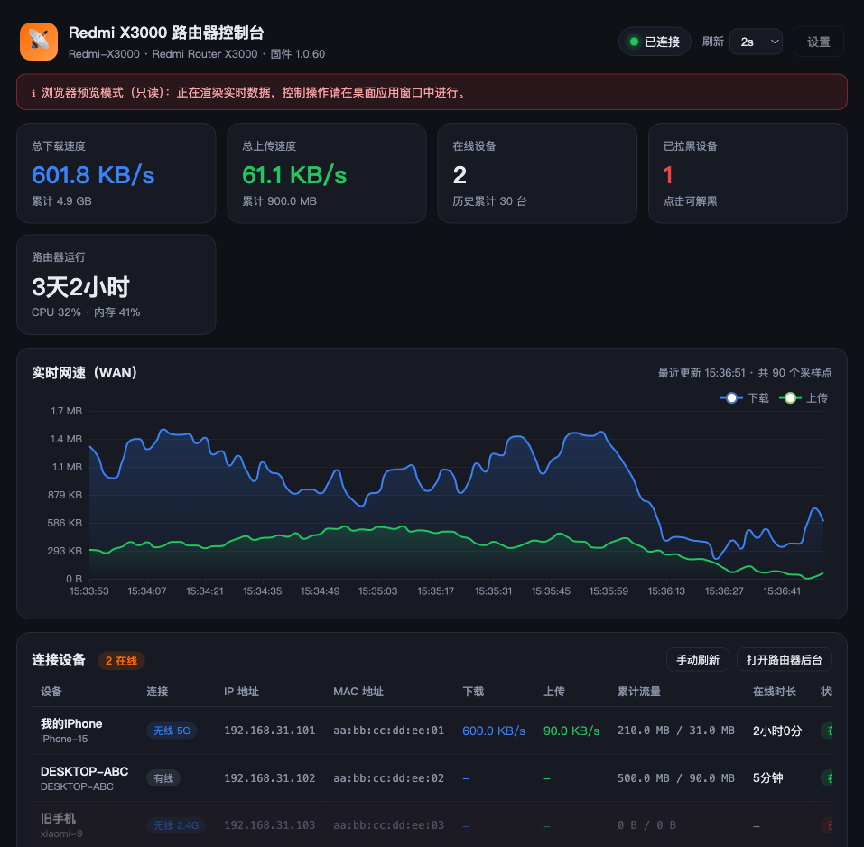

# Redmi AX3000 Controller

[](https://github.com/remixjc/Redmi_AX3000_Controller/stargazers)

**English** | [简体中文](README.md)

A macOS desktop app to monitor and control your **Redmi Router X3000** (AX3000 series) — and any other Xiaomi / Redmi router running MiWiFi firmware — right from your Mac.

It talks to your router over the MiWiFi LuCI HTTP API on your LAN, shows every connected device with live speeds, and lets you block/unblock devices, rename them, and reboot the router — no cloud, no account required.



## Features

**Real-time monitoring**

- WAN download / upload speed and cumulative traffic, plotted on a live chart (last 300 samples)
- Online device count, total known devices, router uptime, CPU & memory usage
- Per-device: name, IP, MAC, wired/wireless & band, live up/down speed, traffic, online duration

**Device control**

- Block / unblock devices (MAC address filtering — cut a device off the internet or restore it)
- Rename device notes
- One-click router reboot (with confirmation)

**Other**

- Configurable polling interval (1–10 s)
- Open the router's web admin page
- Admin password stored in the macOS Keychain, never written to disk in plaintext (fallback documented below)

## Supported Routers

Built on the generic MiWiFi LuCI HTTP API used across Xiaomi / Redmi firmware. **Redmi Router X3000 (AX3000 series, RA81) is natively supported**; Xiaomi AX3000T / AX1800 / Mi Router Pro and similar models also work.

Default admin address: `192.168.31.1` (or `miwifi.com`).

## Requirements

- macOS
- Python 3.10+ (a `.venv` with pinned dependencies is used; auto-created on first launch)

## Quick Start

```bash
git clone git@github.com:remixjc/Redmi_AX3000_Controller.git
cd Redmi_AX3000_Controller

# Option A — double-click the launcher (auto-creates .venv and installs deps on first run)
./启动.command

# Option B — run manually
python3 -m venv .venv
.venv/bin/pip install -r requirements.txt
.venv/bin/python app.py
```

On first launch the connection dialog appears:

1. **Router address** — default `192.168.31.1` (your Mac must be on the same LAN; wired is most reliable)
2. **Username** — default `admin`
3. **Password** — your router admin password (if forgotten, use the hardware reset button to factory-reset the router)
4. Click **Test Connection**, then **Save & Connect**

## FAQ

| Issue | Resolution |
|---|---|
| "Cannot reach router" | Confirm the Mac is on the same LAN and the address is correct; prefer a wired connection |
| "Not a recognized MiWiFi router" | The address is not a Xiaomi/Redmi router, or the login page differs |
| "Login failed / wrong password" | Password is wrong or was changed; after a router reset, reconfigure the app |
| Slow refresh | Increase the polling interval in Settings |
| Device still has internet after blocking | Some firmware takes ~1 min to apply; reconnect the device after blocking |
| Remote access | This app is LAN-only; remote use requires port-forwarding/VPN at your own security risk |

## Security Notes

- The admin password is stored via the macOS Keychain (`security add-generic-password`). If the system blocks Keychain writes, the app falls back to storing it in `config.json` (local plaintext — keep the file private; it is git-ignored).
- The app talks to your router's local HTTP admin interface only — it never connects to any cloud service.
- Block/reboot operations modify router state and are always double-confirmed in the UI.

## Testing

Two test suites run against a built-in **mock router** (no real hardware needed):

```bash
.venv/bin/python tests/test_mock_router.py        # protocol-level suite (24 assertions)
.venv/bin/python tests/test_mock_router.py --serve 18080   # persistent demo server
.venv/bin/python tests/test_app_backend.py        # app backend end-to-end (18 assertions)
```

The mock verifies the login signature flow, device parsing (including float-string fields real firmware returns), and block/unblock/rename/reboot request bodies, plus wrong-password handling.

## Project Structure

```
router/
├── app.py                 # Desktop app entry (pywebview window + polling + control logic)
├── router_api.py          # MiWiFi router protocol client (login, devices, control)
├── ui/                    # Frontend (HTML/CSS/JS + local ECharts)
│   └── vendor/echarts.min.js
├── tests/
│   ├── test_mock_router.py   # Mock router service + protocol tests
│   └── test_app_backend.py   # Headless app backend tests
├── 启动.command           # Double-click launcher
├── config.json            # Generated at runtime (git-ignored)
└── requirements.txt
```

## How It Works (for developers)

**Login flow (new firmware):** `GET /cgi-bin/luci/web` → extract `key` and `deviceId` → build `nonce` → sign password as `sha1(nonce + sha1(password + key))` → `POST /cgi-bin/luci/api/xqsystem/login` → use the returned `token` (stok) in `;stok=<token>/` for all subsequent API calls.

**Core endpoints:**

| Endpoint | Purpose |
|---|---|
| `api/misystem/devicelist` | Device list (name / IP / online state) |
| `api/misystem/status` | WAN speeds + per-device speed/traffic |
| `api/xqnetwork/wifi_macfilter_info` + `set_mac_filter` | Block / unblock (`authority.wan` / `wan=0|1`) |
| `api/xqsystem/set_device_nickname` | Rename device |
| `api/xqsystem/reboot` | Reboot router |

## Disclaimer

This project is unofficial. It is built from community-reverse-engineered MiWiFi HTTP APIs and has **no affiliation with Xiaomi / Redmi**. API behavior may change with firmware updates.
