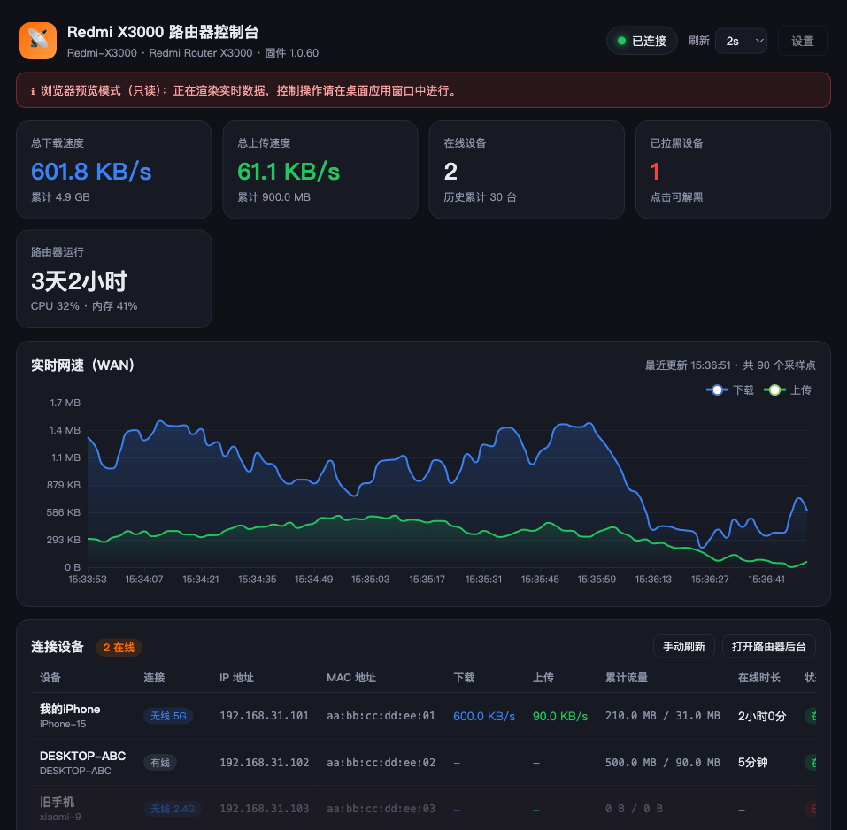

# Redmi AX3000 Controller

[](https://github.com/remixjc/Redmi_AX3000_Controller/stargazers)

[English](README.en.md) | **简体中文**

一款运行在 macOS 上的桌面软件：连接你的 **Redmi 路由器 X3000（AX3000 系列）**，以及其他运行 MiWiFi 固件的小米/红米路由器，实时监控所有连接设备的信息与网速，并可直接对设备进行控制。

软件通过局域网内的 MiWiFi LuCI HTTP 接口与路由器通信，展示每台设备的实时速率，支持拉黑/解黑设备、修改设备名、重启路由器——**不依赖任何云端服务，无需注册账号**。



## 功能特性

**实时监控**

- WAN 总下载 / 上传速度与累计流量，实时曲线图（最近 300 个采样点）
- 在线设备数、历史累计设备数、路由器运行时间、CPU / 内存占用
- 每台设备：名称、IP、MAC、有线/无线与频段、实时上下行速度、累计流量、在线时长

**设备控制**

- 拉黑 / 解除拉黑设备（MAC 地址过滤——禁止或恢复设备上网）
- 修改设备备注名称
- 一键重启路由器（带二次确认）

**其他**

- 刷新间隔可调（1s–10s）
- 打开路由器网页后台
- 管理密码存入 macOS 钥匙串（Keychain），不明文落盘（回退方案见安全说明）

## 支持的路由器

基于小米/红米 MiWiFi 固件的通用 LuCI HTTP API 开发。**Redmi 路由器 X3000（AX3000 系列，RA81）原生支持**；小米 AX3000T / AX1800 / 小米路由器 Pro 等型号同样适用。

默认管理地址：`192.168.31.1`（或 `miwifi.com`）。

## 环境要求

- macOS
- Python 3.10+（项目使用自带 `.venv` 虚拟环境与锁定依赖，首次运行自动创建）

## 快速开始

```bash
git clone git@github.com:remixjc/Redmi_AX3000_Controller.git
cd Redmi_AX3000_Controller

# 方式一：双击「启动.command」（首次运行自动创建 .venv 并安装依赖）
./启动.command

# 方式二：终端手动运行
python3 -m venv .venv
.venv/bin/pip install -r requirements.txt
.venv/bin/python app.py
```

首次启动会弹出「连接设置」：

1. **路由器地址**：默认 `192.168.31.1`（电脑需与路由器在同一局域网，有线连接最稳妥）
2. **用户名**：默认 `admin`
3. **密码**：路由器网页后台登录密码（忘记密码需用硬件复位键恢复出厂）
4. 点击「测试连接」确认，再「保存并连接」

## 常见问题

| 问题 | 处理 |
|---|---|
| 提示「无法访问路由器」 | 确认电脑与路由器在同一局域网、地址正确；有线连接最稳妥 |
| 提示「不是可识别的 MiWiFi 路由器」 | 该地址不是小米/红米路由器，或登录页结构异常 |
| 提示「登录失败/密码错误」 | 密码错误或路由器后台密码已修改；重置路由器后需重新配置 |
| 刷新慢 | 在「设置」里调大刷新间隔 |
| 某设备「拉黑」后仍能上网 | 个别固件对已连接设备生效有约 1 分钟延迟，可先重连设备再拉黑 |
| 想远程控制 | 本软件仅支持局域网内控制；远程需自行配置端口映射/VPN，并评估安全风险 |

## 安全说明

- 管理密码通过 macOS 钥匙串保存（`security add-generic-password`）；若系统策略拦截钥匙串写入，会回退存到 `config.json`（本地明文——请妥善保管该文件，它已在 `.gitignore` 中排除）。
- 软件只在局域网内访问路由器 HTTP 管理接口，不连接任何云端。
- 拉黑 / 重启属于对路由器状态的修改操作，界面均做了二次确认。

## 测试

内置 **Mock 路由器**，无需真实硬件即可运行两套测试：

```bash
.venv/bin/python tests/test_mock_router.py        # 协议层测试（24 项断言）
.venv/bin/python tests/test_mock_router.py --serve 18080   # 常驻演示服务
.venv/bin/python tests/test_app_backend.py        # 应用后端端到端（18 项断言）
```

Mock 覆盖登录签名流程、设备解析（含真实固件返回的浮点字符串字段）、拉黑/解黑/改名/重启请求体，以及错误密码场景。

## 项目结构

```
router/
├── app.py                 # 桌面应用入口（pywebview 窗口 + 轮询 + 控制逻辑）
├── router_api.py          # MiWiFi 路由器协议客户端（登录、设备、控制）
├── ui/                    # 前端界面（HTML/CSS/JS + 本地 ECharts）
│   └── vendor/echarts.min.js
├── tests/
│   ├── test_mock_router.py   # Mock 路由器服务 + 协议测试
│   └── test_app_backend.py   # 无头后端测试
├── 启动.command           # 双击启动器
├── config.json            # 运行时生成（已 git 忽略）
└── requirements.txt
```

## 技术说明（开发者）

**登录流程（新固件）：** `GET /cgi-bin/luci/web` 抓取 `key` 与 `deviceId` → 构造 `nonce` → 密码签名 `sha1(nonce + sha1(password + key))` → `POST /cgi-bin/luci/api/xqsystem/login` 获取 `token`（stok）→ 后续所有接口携带 `;stok=<token>/`。

**核心接口：**

| 接口 | 用途 |
|---|---|
| `api/misystem/devicelist` | 设备列表（名称 / IP / 在线状态） |
| `api/misystem/status` | WAN 速度 + 每设备速度/流量 |
| `api/xqnetwork/wifi_macfilter_info` + `set_mac_filter` | 拉黑 / 解黑（`authority.wan` / `wan=0|1`） |
| `api/xqsystem/set_device_nickname` | 设备改名 |
| `api/xqsystem/reboot` | 重启路由器 |

## 免责声明

本项目为**非官方项目**，基于社区逆向整理的 MiWiFi HTTP 接口开发，与小米/红米公司**无任何关联**；接口行为可能随固件更新而变化。
